# 🔐 Awesome User Identity, Profile & Account Management 👤

> 🌟 A curated directory and strategic benchmark of leading **User Identity, Profile, and Account Management (CIAM / IAM)** platforms — comparing market size, valuation/scale, transparent starting tier pricing, explicit free tier limits, and top open-source self-hosted solutions.

---

## 📑 Table of Contents

- [🌐 Sector Overview & Market Dynamics](#-sector-overview--market-dynamics)
- [🟦 SaaS / Hosted Platforms](#-saas--hosted-platforms)
  - [SaaS Comparison Matrix](#saas-comparison-matrix-ranked-by-company-scale)
  - [SaaS Deep Dives](#saas-deep-dives)
- [🟩 Open-Source Software](#-open-source-software)
  - [Open-Source Solutions Ranked by GitHub_Stars](#open-source-solutions-ranked-by-github-stars)
  - [Open-Source Deep Dives](#open-source-deep-dives)
- [📊 Feature Comparison at a Glance](#-feature-comparison-at-a-glance)
- [🔍 Evaluation Criteria & Buyer Guide](#-evaluation-criteria--buyer-guide)
- [🤝 Contributing](#-contributing)
- [💖 Support](#-support)
- [📈 Star History](#-star-history)
- [📄 License](#-license)

---

## 🌐 Sector Overview & Market Dynamics

The global **Identity and Access Management (IAM)** and **Customer Identity and Access Management (CIAM)** market is valued at approximately **$18.5 Billion to $20.2 Billion in 2024–2025** and is projected to expand to over **$42 Billion by 2030** (CAGR ~13.8–14.5%).

The sector exhibits **moderate fragmentation with high concentration at the enterprise tier**:
- **Workforce IAM** is dominated by a concentrated duopoly and enterprise incumbents (notably Microsoft Entra ID and Okta).
- **Customer Identity (CIAM) & Developer Auth** remains **moderately fragmented**, characterized by intense competition between developer-first platforms (Clerk, Auth0/Okta, Stytch) and next-generation open-source / sovereign self-hosted solutions (Keycloak, Authentik, Ory, Zitadel). The market does not follow a strict "winner-take-all" dynamic due to stringent global data residency mandates (GDPR, HIPAA, CCPA), protocol diversity (OIDC, SAML, WebAuthn/Passkeys), and growing customer demand to eliminate vendor lock-in and steep per-MAU scaling penalties.

---

## 🟦 SaaS / Hosted Platforms

Below is the benchmark table of major hosted Identity, Profile, and Account Management platforms, sorted by **Company Scale (Valuation / Revenue in Descending Order)**.

### SaaS Comparison Matrix (Ranked by Company Scale)

| 🏢 Platform | 🏛️ Company Scale (Valuation / Revenue) | 💰 Starting Tier Pricing | 🎁 Free Tier Limit / Trial Policy | 🎯 Primary Category & Focus |
|:---|:---|:---|:---|:---|
| [**Microsoft Entra ID**](https://entra.microsoft.com/) | **~$3.1 Trillion** (Market Cap; Entra suite ARR >$3B) | **$3.00/user/month** (Entra ID P1; or bundled in M365 E3/E5); External ID: **$0.016/MAU** | **50,000 Free MAUs/month** forever for External ID; Free tier included with all Azure / M365 subscriptions | Enterprise Workforce IAM & Cloud CIAM |
| [**Ping Identity**](https://www.pingidentity.com/) | **~$6.5 Billion** (Acquired by Thoma Bravo; ForgeRock merged) | **$3.00/user/month** (PingOne for Workforce baseline; Essentials tier); PingOne Cloud CIAM from **$20,000/year** | **30-Day Free Trial** (Full enterprise cloud access, up to 100 test user accounts; no credit card required) | Enterprise Hybrid IAM, Federation & CIAM |
| [**OneLogin**](https://www.onelogin.com/) | **~$2.5 Billion** (Parent One Identity / Quest Software; ~$500M+ revenue) | **$2.00/user/month** (Advanced Directory); **$4.00/user/month** (Enterprise SSO/MFA tier) | **30-Day Free Trial** (Unlimited enterprise features for up to 25 users; no credit card required) | Workforce Single Sign-On (SSO) & Directory IAM |
| [**Auth0**](https://auth0.com/) | **~$6.5 Billion** (Acquisition valuation by Okta; Okta ARR >$2.4B) | **$35.00/month** (B2C Essentials, covers up to 1,000 MAUs; +$0.07/extra MAU); **$130.00/month** (B2B Essentials) | **7,500 Free MAUs/month** forever (Unlimited logins, social connections, basic MFA, community support) | Developer CIAM & B2B Application Authentication |
| [**Okta Customer Identity**](https://www.okta.com/) | **~$12.5 Billion** (Public Market Cap NASDAQ: OKTA; >$2.4B ARR) | **$1,500.00/year** ($125/month entry tier for Workforce); Auth0/CIAM starting at **$35.00/month** | **30-Day Free Trial** for Workforce Cloud; Auth0 Developer tier free forever up to **7,500 MAUs** | Enterprise Workforce SSO, Lifecycle & CIAM |
| [**Stytch**](https://stytch.com/) | **~$1.0 Billion** (Series B Valuation; >$90M raised) | **$99.00/month** (Growth tier, covers up to 10,000 MAUs; $0.01/additional MAU) | **5,000 Free MAUs/month** forever (Includes Email Magic Links, Passkeys/WebAuthn, SMS OTP & OAuth) | Developer-First Passwordless & Consumer UX Auth |
| [**Descope**](https://www.descope.com/) | **~$400 Million** (Series A Valuation; $53M raised) | **$99.00/month** (Pro B2C, covers up to 10,000 MAUs) / **$249.00/month** (Pro B2B, includes 100 SSO connections) | **7,500 Free MAUs/month** forever (or 100 SSO enterprise tenants, complete drag-and-drop workflow canvas) | Drag-and-Drop Visual Auth & CIAM Workflows |
| [**Clerk**](https://clerk.com/) | **~$350 Million** (Series B Valuation; $55M raised) | **$25.00/month** (Pro Plan, includes 1,000 MAUs; +$0.02/extra MAU, $100/mo SAML SSO add-on) | **10,000 Free MAUs/month** forever (Unlimited sign-ins, turnkey profile UI components, social logins, passkeys) | React, Next.js & Modern Full-Stack CIAM |
| [**Frontegg**](https://frontegg.com/) | **~$250 Million** (Series B Valuation; $70M raised) | **$99.00/month** (Starter tier for B2B SaaS, up to 1,000 MAUs; $0.05/extra MAU; $499/mo Growth) | **2,500 Free MAUs/month** forever (Multi-tenant management, self-serve account portal, RBAC) | B2B SaaS Customer Identity & Self-Service Portals |

---

### SaaS Deep Dives

#### 🏢 Okta & Auth0
- **Primary Type:** Enterprise Workforce Identity & Developer CIAM
- **Architecture:** Cloud-native multi-tenant SaaS with global edge distribution.
- **Key Features:** SSO, adaptive MFA, Universal Directory, SCIM provisioning, B2B organization modeling, OpenID Connect / SAML2 certification.
- **Strengths:** Market leader in breadth of SaaS integrations (7,000+ connectors) and developer ecosystem SDKs.

#### 🪟 Microsoft Entra ID (Formerly Azure AD)
- **Primary Type:** Enterprise Cloud Directory, Workforce & External ID CIAM
- **Architecture:** Deeply integrated into the Microsoft Azure and M365 hyper-scale cloud.
- **Key Features:** Conditional Access policies, Privileged Identity Management (PIM), external guest accounts, seamless Windows/Office integration.
- **Strengths:** Highly economical for organizations already subscribed to Microsoft 365 E3/E5, scaling to 50k external MAUs without charge.

#### 🛡️ Ping Identity
- **Primary Type:** Enterprise Federation & Large-Scale Identity Orchestration
- **Architecture:** Hybrid cloud, private cloud (PingFederate, PingDirectory), and multi-tenant SaaS (PingOne).
- **Key Features:** Complex SAML/OIDC federation chains, legacy web access management migration, multi-million user scalability.
- **Strengths:** Premier choice for heavily regulated financial, government, and healthcare institutions with hybrid on-prem requirements.

#### ⚛️ Clerk
- **Primary Type:** Developer-First Authentication for React & Modern Frameworks
- **Architecture:** Hosted API with pre-built, beautifully styled frontend UI components (React, Next.js, Remix, Astro, Vue).
- **Key Features:** Drop-in `<UserProfile />` and `<SignIn />` components, multi-tenant organization switching, session management, WebAuthn.
- **Strengths:** Fastest time-to-market for Next.js and frontend teams building B2B/B2C SaaS.

#### ⚡ Stytch
- **Primary Type:** High-Conversion Passwordless Authentication & Fraud Prevention
- **Architecture:** Headless, API-first authentication engine with native device-fingerprinting and bot detection.
- **Key Features:** Biometrics, passkeys, WebAuthn, magic links, OTPs via SMS/WhatsApp, and built-in Device Fingerprinting against credential stuffing.
- **Strengths:** Full UI customization control without forced hosted widgets; exceptional frictionless UX.

#### 🎨 Descope
- **Primary Type:** No-Code / Low-Code Visual Identity Flow Designer
- **Architecture:** Workflow canvas managing end-to-end authentication states, conditional routing, and token minting.
- **Key Features:** Visual drag-and-drop designer for login, verification, and KYC flows without code redeployment; Passkeys; Enterprise SSO.
- **Strengths:** Allows product managers and security teams to iterate on onboarding and authentication flows without engineering sprints.

#### 💼 Frontegg
- **Primary Type:** End-to-End B2B SaaS CIAM & Self-Service Customer Portal
- **Architecture:** Embedded customer-facing account and admin workspace.
- **Key Features:** Self-service tenant onboarding, granular role and permission assignment (RBAC), team member invites, audit logs, and subscription gating.
- **Strengths:** Turnkey customer account management portal out-of-the-box for multi-tenant B2B SaaS.

#### 🔑 OneLogin
- **Primary Type:** Enterprise Workforce IAM with Lightweight Directory Sync
- **Architecture:** Cloud SSO and identity broker.
- **Key Features:** Active Directory and LDAP sync, SmartFactor Authentication, application catalog SSO, desktop agent for endpoint login.
- **Strengths:** Straightforward setup and lower operational overhead compared to heavy legacy federation engines.

---

## 🟩 Open-Source Software

Self-hosted, transparent, and community-driven Identity, Profile, and Account Management solutions. Listed below sorted by **GitHub_Stars in Descending Order**.

### Open-Source Solutions Ranked by GitHub_Stars

| 📦 Repository | ⭐ GitHub_Stars | 📜 License | 🛠️ Tech Stack | 🚀 Deployment Model | 💡 Best Fit |
|:---|:---:|:---|:---|:---|:---|
| [**Keycloak**](https://github.com/keycloak/keycloak) |  | Apache-2.0 | Java / Quarkus | Docker, Kubernetes (Operator), Bare-Metal | Battle-tested, enterprise-grade IAM with wide protocol support |
| [**Authelia**](https://github.com/authelia/authelia) |  | Apache-2.0 | Go / TypeScript | Single Binary, Docker, Reverse Proxy companion | Reverse proxy authentication companion (Traefik, Nginx, Caddy) |
| [**Authentik**](https://github.com/goauthentik/authentik) |  | MIT (Core) / Open Core | Python (Django) / Go | Docker Compose, Kubernetes Helm | Flexible flow-based login execution and forward-proxy gateway |
| [**Ory Hydra**](https://github.com/ory/hydra) |  | Apache-2.0 | Go | Headless Binary, Docker, Kubernetes | Ultra-hardened, OpenID Certified OAuth 2.0 / OIDC engine |
| [**Zitadel**](https://github.com/zitadel/zitadel) |  | Apache-2.0 | Go / CockroachDB | Single Binary, Docker, Cloud-Native K8s | Modern cloud-native B2B multi-tenancy and audit compliance |
| [**SuperTokens**](https://github.com/supertokens/supertokens-core) |  | Apache-2.0 (Core) | Java / TypeScript / Python | Embedded Backend Core + Frontend SDKs | Developer-embedded session management and customizable auth |
| [**Logto**](https://github.com/logto-io/logto) |  | MPL-2.0 | Node.js / TypeScript / React | Docker Compose, Helm, Cloud | Modern self-hosted Auth0/Clerk alternative with multi-tenancy |
| [**Casdoor**](https://github.com/casdoor/casdoor) |  | Apache-2.0 | Go / React (Single Binary) | Single Binary, Docker, Helm | All-in-one IAM with 70+ built-in social OAuth providers |
| [**Ory Kratos**](https://github.com/ory/kratos) |  | Apache-2.0 | Go | Headless Binary, Docker, K8s | Headless user identity, profile management, and registration |
| [**Apereo CAS**](https://github.com/apereo/cas) |  | Apache-2.0 | Java / Spring Boot | Java WAR, Docker, Kubernetes | Higher-education and enterprise web single sign-on |
| [**Dex IdP**](https://github.com/dexidp/dex) |  | Apache-2.0 | Go | Single Binary, Kubernetes Native | Pluggable OIDC / SAML / LDAP identity broker for Kubernetes |
| [**Stack Auth**](https://github.com/stack-auth/stack) |  | Apache-2.0 / AGPL | TypeScript / Next.js | Docker, Node.js, Cloud-Ready | 100% open-source Clerk alternative tailored for Next.js apps |
| [**Kanidm**](https://github.com/kanidm/kanidm) |  | MPL-2.0 | Rust | Standalone Binary, Container | High-performance, memory-safe directory server and IdP in Rust |
| [**Ory Keto**](https://github.com/ory/keto) |  | Apache-2.0 | Go | Headless Microservice, Docker | Google Zanzibar-inspired Relationship-Based Access Control (ReBAC) |
| [**Authgear**](https://github.com/authgear/authgear-server) |  | Apache-2.0 | Go | Single Binary, Docker, Kubernetes | Consumer CIAM with pre-built user account settings & SMS/WhatsApp |
| [**Rauthy**](https://github.com/sebadob/rauthy) |  | Apache-2.0 | Rust / WebAssembly | Single Binary, Alpine Container | Ultra-lightweight, high-speed OIDC server with passkey support |
| [**Apache Syncope**](https://github.com/apache/syncope) |  | Apache-2.0 | Java | Enterprise Java Application | Open-source digital identity lifecycle management & provisioning |
| [**FusionAuth**](https://github.com/FusionAuth/fusionauth-issues) |  | Proprietary / Free Self-Host | Java | Docker, ZIP, RPM/DEB Packages | Self-hosted customer identity platform with free community edition |
| [**Idenplane**](https://github.com/idenplane/idenplane) |  | Apache-2.0 | TypeScript / NestJS | Docker, Node.js Container | Lightweight (<150MB RAM) Keycloak & Auth0 alternative with SCIM |

---

### Open-Source Deep Dives

#### 👑 [Keycloak](https://github.com/keycloak/keycloak)
- **Tech Stack:** Java, Quarkus
- **Protocol Standards:** OpenID Connect 1.0, OAuth 2.0, SAML 2.0, Kerberos, LDAP.
- **Why It Stands Out:** Maintained under Red Hat, Keycloak is the industry benchmark for open-source IAM. It provides clustering, high availability, complete user profile SPI extensions, social brokering, and fine-grained authorization services.

#### 🛡️ [Authelia](https://github.com/authelia/authelia)
- **Tech Stack:** Go, React, TypeScript
- **Protocol Standards:** OpenID Connect, Forward Auth, LDAP.
- **Why It Stands Out:** Designed specifically to protect applications behind reverse proxies (Nginx, Traefik, Caddy, HAProxy). Provides 2FA via WebAuthn, Duo, and TOTP, making it a favorite for homelabs and enterprise edge ingress security.

#### ⚡ [Authentik](https://github.com/goauthentik/authentik)
- **Tech Stack:** Python (Django), Go, PostgreSQL, Redis
- **Protocol Standards:** OIDC, SAML, SCIM, LDAP Outpost, Proxy Provider.
- **Why It Stands Out:** Features an expressive stage/flow execution engine. Administrators can design visual, Python-scripted enrollment, authentication, and recovery pipelines with integrated forward-auth proxy capabilities.

#### 🌐 [Ory Suite (Hydra, Kratos, Keto)](https://github.com/ory)
- **Tech Stack:** Go
- **Protocol Standards:** OpenID Certified OAuth 2.0 / OIDC, Zanzibar ReBAC.
- **Why It Stands Out:** Completely headless, zero-UI microservice philosophy. Teams adopt individual microservices: **Hydra** (OAuth2/OIDC server), **Kratos** (user identity, profile management, credentials), and **Keto** (Google Zanzibar-style permissions engine).

#### 🏢 [Zitadel](https://github.com/zitadel/zitadel)
- **Tech Stack:** Go, CockroachDB / PostgreSQL
- **Protocol Standards:** OIDC, SAML 2.0, OAuth 2.1, Passkeys/FIDO2.
- **Why It Stands Out:** Built from the ground up for multi-tenant B2B architectures. Provides instant tenant isolation, granular self-service administration, and an event-sourced audit trail architecture.

#### 🧩 [SuperTokens](https://github.com/supertokens/supertokens-core)
- **Tech Stack:** Java (Core engine), TypeScript / Python / Go (Backend SDKs), React (Frontend)
- **Protocol Standards:** Session tokens, OAuth 2.0, Social Login, Passwordless.
- **Why It Stands Out:** Embedded architecture where security and session tokens live directly inside your existing microservice codebase, preventing the redirection latency of external IAM dashboards.

#### 🚀 [Logto](https://github.com/logto-io/logto)
- **Tech Stack:** Node.js, TypeScript, PostgreSQL
- **Protocol Standards:** OIDC, OAuth 2.0, WebAuthn.
- **Why It Stands Out:** Offers a modern frontend and developer experience comparable to Clerk and Auth0. Features built-in organization tenancy, multi-language pre-built login UIs, machine-to-machine authorization, and dark-mode admin consoles.

#### 🚪 [Casdoor](https://github.com/casdoor/casdoor)
- **Tech Stack:** Go, React
- **Protocol Standards:** OAuth 2.0, OIDC, SAML 2.0, CAS, RADIUS, WebAuthn.
- **Why It Stands Out:** Deploys as a compact single binary supporting over 70 OAuth identity providers (Google, GitHub, Apple, WeChat, DingTalk, Slack, etc.) and native integration with the Casbin RBAC/ABAC authorization framework.

#### 📦 [Dex IdP](https://github.com/dexidp/dex)
- **Tech Stack:** Go
- **Protocol Standards:** OpenID Connect identity broker.
- **Why It Stands Out:** Acts as an authentication gateway connecting your applications to SAML, LDAP, GitHub, GitLab, and OpenID providers. Highly popular in Kubernetes infrastructure to authenticate kubectl and cluster operators.

#### 🦀 [Kanidm](https://github.com/kanidm/kanidm)
- **Tech Stack:** Rust, WebAssembly
- **Protocol Standards:** OAuth 2.0, OIDC, RADIUS, LDAP compatibility layer.
- **Why It Stands Out:** A modern, memory-safe alternative to OpenLDAP, 389ds, and Active Directory. Engineered in Rust for high reliability, fast cryptographic execution, and integrated WebAuthn/passkey support.

#### ⚙️ [Stack Auth](https://github.com/stack-auth/stack)
- **Tech Stack:** TypeScript, Next.js, PostgreSQL
- **Protocol Standards:** OAuth 2.0, Magic Links, Passkeys.
- **Why It Stands Out:** Tailored specifically for Next.js and React full-stack engineers as a self-hostable clone of Clerk with drop-in components, full database ownership, and no telemetry lock-in.

---

## 📊 Feature Comparison at a Glance

| Solution | Deployment | License | Multi-Tenancy | Passkeys / WebAuthn | SCIM Provisioning | Reverse Proxy Gateway |
|:---|:---:|:---:|:---:|:---:|:---:|:---:|
| **Microsoft Entra ID** | Cloud | Commercial | ✅ Dedicated | ✅ Native | ✅ SCIM 2.0 | ✅ App Proxy |
| **Ping Identity** | Cloud / On-Prem | Commercial | ✅ Advanced | ✅ Native | ✅ SCIM 2.0 | ✅ PingAccess |
| **Auth0 / Okta** | Cloud | Commercial | ✅ Native | ✅ Native | ✅ SCIM 2.0 | ❌ Third-party |
| **Clerk** | Cloud | Commercial | ✅ Organizations | ✅ Native | ❌ Roadmap | ❌ API-first |
| **Keycloak** | Self-Hosted / K8s | Apache-2.0 | ✅ Realms | ✅ Native | ⚠️ Via Plugin | ⚠️ Gatekeeper |
| **Authentik** | Self-Hosted / Cloud | MIT (Core) | ✅ Brands / Flow | ✅ Native | ✅ Native SCIM | ✅ Built-in Outpost |
| **Authelia** | Self-Hosted | Apache-2.0 | ❌ Single Domain | ✅ Native | ❌ N/A | ✅ Forward-Auth Native |
| **Zitadel** | Self-Hosted / Cloud | Apache-2.0 | ✅ Native Orgs | ✅ Native | ✅ SCIM 2.0 | ❌ Headless / API |
| **Logto** | Self-Hosted / Cloud | MPL-2.0 | ✅ Organizations | ✅ Native | ⚠️ In Development | ❌ Headless / SDK |
| **Casdoor** | Self-Hosted | Apache-2.0 | ✅ Organizations | ✅ Native | ⚠️ Basic | ❌ Admin UI |
| **Ory (Hydra/Kratos)** | Self-Hosted / Cloud | Apache-2.0 | ✅ Namespaces | ✅ Native | ⚠️ Via API | ✅ Oathkeeper Proxy |
| **Stack Auth** | Self-Hosted / Cloud | Apache-2.0 / AGPL | ✅ Teams | ✅ Native | ❌ N/A | ❌ Frontend SDK |
| **Kanidm** | Self-Hosted | MPL-2.0 | ⚠️ Domains | ✅ Native | ❌ LDAP bridge | ❌ PAM / RADIUS |

---

## 🔍 Evaluation Criteria & Buyer Guide

When selecting between a commercial SaaS platform and an open-source self-hosted IAM engine, consider the following trade-offs:

1. **Total Cost of Ownership (TCO) vs. Engineering Maintenance:**
   - **SaaS** platforms (Auth0, Clerk, Okta) charge steep rates per Monthly Active User (MAU) as your application scales beyond free tiers, but eliminate maintenance overhead, security patching, and uptime liability.
   - **Self-Hosted OSS** platforms (Keycloak, Authentik, Zitadel) have **$0 licensing fees**, allowing millions of active identities at infrastructure cost only. However, your team assumes responsibility for database clustering, high availability, cryptographic key rotation, and disaster recovery.

2. **Data Sovereignty & Regulatory Compliance:**
   - Regulated organizations (GDPR in the EU, HIPAA in US healthcare, PCI-DSS, defense) often require absolute control over customer database residency and encryption keys, making open-source self-hosted solutions or dedicated private clouds mandatory.

3. **User Profile UX & Onboarding Speed:**
   - If time-to-market is the primary objective, modern developer SDKs (Clerk, Logto, Stack Auth) provide pre-built `<UserProfile />` modals and onboarding widgets that save hundreds of engineering hours compared to customizing classic enterprise IAM themes.

---

## 🤝 Contributing

Contributions are warmly welcome! If you know of an identity, user profile, or account management solution that belongs on this list:

1. 🍴 Fork the repository.
2. 🌿 Create a feature branch: `git checkout -b add-identity-tool`.
3. 📝 Add your entry to the appropriate section with correct markdown formatting and accurate Stars_Counts / pricing metrics.
4. 🚀 Open a Pull Request with a short summary of why the platform should be included.

---

## 💖 Support

Thank you for exploring and using this curated resource! If this project helped you discover the right IAM or CIAM platform for your stack, here is how you can support its ongoing maintenance:

- ⭐ **Star this repository** on GitHub to increase its visibility.
- 🍴 **Fork and share** it with your engineering team, peers, or communities.
- ☕ **Buy a coffee & sponsor**: You can sponsor or support future updates directly through the [GitHub Sponsor Dashboard](https://github.com/sponsors/ishandutta2007).

---

## 📈 Star History

---

## 📄 License

This repository and curated list are made available under the [Creative Commons Zero v1.0 Universal](https://creativecommons.org/publicdomain/zero/1.0/) (CC0 1.0 - Public Domain Dedication). Software packages, logos, and platforms mentioned retain their respective trademarks and licenses.

---

⭐ **Found this guide helpful? Give it a Star on GitHub!** ⭐

